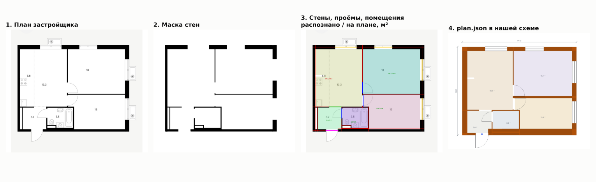
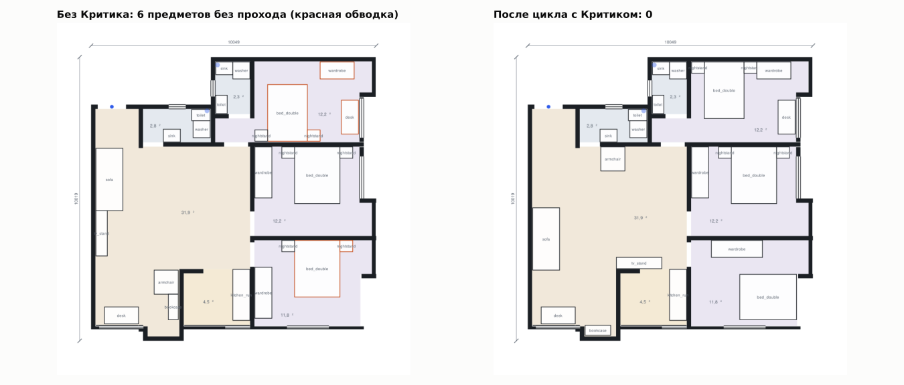

# AI-генератор дизайн-проекта квартиры

AI-генератор дизайн-проекта квартиры. Проект по Многоагентным системам ИИ.

На вход — план квартиры от застройщика и пожелания клиента, на выходе — распознанная
планировка, предложения по перепланировке и расстановка мебели и сантехники. На каждом
этапе пользователь может оставить правку, и система перестраивает только то, что от неё зависит.

Готово:
- **шаг 0** — общий фундамент для всех агентов: схема данных, геометрия, валидатор,
  отрисовка и конвертеры датасетов;
- **Обмерщик v0** (шаг 1) — распознавание маркетинговых планов застройщиков без обучения,
  с метрикой по подписанным площадям. Подробности и цифры — `docs/recognition.md`;
- **расстановка v0** (шаг 3) — каталог мебели и сантехники, солвер CP-SAT для каждой комнаты,
  геометрический Критик, который возвращает комнату на пересчёт, и частичная перегенерация
  по правке. Типы комнат после распознавания угадываются простыми правилами.
  Подробности и цифры — `docs/layout.md`;
- **LLM-агенты** — Аналитик брифа и Агент правок переводят текст в ограничения, а Оркестратор
  ведёт версии и пересчитывает только затронутые комнаты. Модель — локальная Ollama или
  любой OpenAI-совместимый API, настраивается в `.env`. Подробности — `docs/agents.md`.





Шаг 2 (перепланировка) — следующий.

## Установка

Нужен Python 3.11+. Рекомендуем [uv](https://docs.astral.sh/uv/):

```bash
uv sync --extra dev --extra recognition   # или: pip install -e ".[dev,recognition]"
uv run pytest              # тесты
```

## Быстрый старт

```bash
# проверить и нарисовать демо-квартиру
uv run aidesign validate data/demo/demo_48.json
uv run aidesign render data/demo/demo_48_state.json -o out/demo.svg

# конвертировать свою разметку LabelMe (правила — docs/annotation.md)
uv run aidesign convert-labelme plans/pik_01.json -o data/plans/pik_01.json

# распознать картинку плана и посчитать метрику по папке
uv run aidesign recognize data/raw_plans/IMG_1662.PNG --debug
uv run aidesign eval-recognition data/raw_plans

# расставить мебель (рядом появится .svg), потом пересчитать только спальню, оставив кровать
uv run aidesign layout data/demo/demo_48.json -o out/demo_layout.json
uv run aidesign layout out/demo_layout.json --rooms r2 --keep r2_bed --seed 1

# агенты: бриф текстом → версия 1, правки текстом → версии 2, 3, …  (нужна Ollama или API, см. .env.example)
cp .env.example .env && ollama pull qwen2.5:14b-instruct
uv run aidesign llm-check
uv run aidesign brief data/demo/demo_48.json "Живём вдвоём, работаю из дома, только душ" --project demo
uv run aidesign comment demo "Шкаф мешает открыть дверь, перенеси его. Кровать не трогай."
uv run aidesign eval-agents -o out/agents_eval.md

# конвертировать ResPlan: квартиры до 120 м², не больше 3 спален, только без ошибок
uv run aidesign convert-resplan data/external/ResPlan.pkl -o data/resplan --limit 500 \
    --split train --split-file data/external/split.json
```

## Полный пайплайн: от картинки плана до расстановки с правками

### Подготовка (один раз)

```bash
uv sync --extra dev --extra recognition      # зависимости, включая OpenCV и OCR
# Ollama: установить с ollama.com, затем скачать модель (~9 ГБ)
ollama pull qwen2.5:14b-instruct
cp .env.example .env                          # здесь выбирается модель: Ollama или API
uv run aidesign llm-check                     # должно ответить {'ok': True, ...}
```

Положите картинку плана застройщика в `data/raw_plans/`. Эта папка в git не попадает.

### Шаги

```bash
# 1. Распознать план → IMG_1662.plan.json и IMG_1662.plan.debug.png рядом с картинкой
uv run aidesign recognize data/raw_plans/IMG_1662.PNG --debug

# 2. Проверить план и типы комнат (типы угаданы правилами — сверьте с .debug.png)
uv run aidesign validate data/raw_plans/IMG_1662.plan.json
uv run aidesign rooms data/raw_plans/IMG_1662.plan.json
uv run aidesign rooms data/raw_plans/IMG_1662.plan.json --set r3=storage   # если тип неверный

# 3. Бриф → версия 1
uv run aidesign brief data/raw_plans/IMG_1662.plan.json \
    "Живём вдвоём, работаю из дома — стол у окна. Только душ." --project flat1662

# 4. Правки → версии 2, 3, … (каждая правка — к последней версии)
uv run aidesign comment flat1662 "Шкаф мешает открыть дверь, перенеси его"
uv run aidesign comment flat1662 "Стиральную машину перенеси на кухню"
uv run aidesign comment flat1662 "Какая площадь у спальни?"   # вопрос: новой версии не будет
```

Бриф можно взять из файла: `--file brief.txt` вместо текста в кавычках. Правку можно сделать
к старой версии: `--version 1`.

### Что получается

| Где | Что |
|---|---|
| `data/raw_plans/*.plan.json` | распознанный план в нашей схеме |
| `data/raw_plans/*.plan.debug.png` | распознанное поверх исходной картинки: стены, проёмы, площади «распознано / на плане» |
| `projects/<проект>/vNNNN.json` | версия проекта: план, бриф, ограничения, правки, расстановка |
| `projects/<проект>/vNNNN.svg` | картинка расстановки этой версии |
| `projects/<проект>/llm_log.jsonl` | все вызовы модели: промпт, ответ, время, токены |

В консоли после каждой команды печатаются:
- ответ системы;
- предупреждения, например «комната не найдена» или «не нашлось другого места»;
- список ограничений с источником (`brief` или `user`);
- расход модели.

Распознанную квартиру можно не только обставлять агентами, но и расставить без LLM:
`uv run aidesign layout data/raw_plans/IMG_1662.plan.json -o out/flat1662.json`.

### Что учесть на распознанных планах

- Стояков на маркетинговых планах нет, поэтому радиус сантехники не проверяется.
- Открытая кухня-гостиная, разделённая пунктиром, распознаётся одной комнатой.
- Мелкие помещения без окна (кладовки, коридоры) правила иногда принимают за санузлы. Их стоит
  поправить через `rooms --set`, иначе туда попытается встать ванна. Возможные типы: `living`,
  `kitchen`, `kitchen_living`, `bedroom`, `bathroom`, `toilet`, `hall`, `corridor`, `storage`,
  `balcony`, `other`.
- Лучше всего сейчас распознаётся `IMG_1662` — с неё удобно начинать демо.

## Структура

```
src/aidesign/
  schemas/      ProjectState и его части: plan, brief, constraints, layout, comments
  geometry/     площади, зоны дверей, разложение стен, валидатор плана, проверка расстановки
  render/       SVG-рендер плана и расстановки
  converters/   LabelMe → Plan, ResPlan → Plan
  recognition/  Обмерщик v0: картинка плана → Plan (OpenCV + OCR + watershed)
  catalog.py    каталог мебели и сантехники, набор предметов для комнаты по типу и площади
  solver/       расстановка: CP-SAT для одной комнаты, сборка квартиры и цикл с Критиком
  agents/       LLM-клиенты (Ollama / OpenAI-совместимый), Аналитик брифа, Агент правок,
                Оркестратор, оценка агентов
  store.py      версии ProjectState: каждая версия — неизменяемый JSON
  cli.py        команды aidesign validate | render | convert-labelme | convert-resplan |
                recognize | eval-recognition | rooms | layout | llm-check | brief | comment |
                eval-agents
data/demo/      демо-квартира: план и полное состояние с брифом, правкой и расстановкой
data/agents_eval/  размеченные брифы и правки для оценки агентов
docs/           правила разметки, заметки о распознавании и расстановке
tests/
```

Дальше: Нормоконтролёр и перепланировка (шаг 2), объяснение замечаний Критика словами.

## Главные соглашения

- **Единицы — миллиметры, ось y направлена вниз** (как у картинки).
- **Стена** — отрезок `a→b` с толщиной; прямоугольник стены не выходит за `a` и `b`,
  поэтому в углах стены должны перекрываться.
- **Тип стены** хранится отдельно от положения: `position` (exterior / interior) и
  `structural` (load_bearing / partition / unknown). Несущую стену по плану
  определить надёжно нельзя — по умолчанию `unknown`.
- **Проём** задаётся точками на оси стены; стена под ним может быть цельной —
  при отрисовке проём вырезается.
- **Полигон помещения** — внутренний контур по чистовым граням стен.
- **Площади не хранятся** — всегда вычисляются из полигонов (`aidesign.geometry`).
  Подписанная на плане площадь хранится в `label_area_m2` только для проверки.
- **LLM никогда не выдаёт координаты**: геометрию считает код, раскладывает солвер.

## Датасеты

| Датасет | Для чего | Где взять |
|---|---|---|
| ResPlan | готовые планы для шагов 2–3 | [github.com/m-agour/ResPlan](https://github.com/m-agour/ResPlan), `ResPlan.zip` → `ResPlan.pkl`, CC BY 4.0 |
| CubiCasa5K | обучение и проверка распознавания (шаг 1) | [arXiv 1904.01920](https://arxiv.org/abs/1904.01920) |
| свои планы застройщиков | проверка распознавания на российском оформлении | `data/raw_plans/`, без разметки: метрика по подписанным площадям |

Что выяснилось про ResPlan при написании конвертера: координаты в pickle лежат на холсте
~256 единиц, а не в метрах, как сказано в README датасета. Масштаб восстанавливается как
`sqrt(area / inner.area)` (медианная ширина двери получается ~1 м, стены ~0,23 м).
Прихожих и коридоров в ResPlan нет — конвертер достраивает их из остатка `inner`.
Стояков в датасете нет — конвертер ставит их эвристикой (`inferred: true`).
На случайной выборке из 300 квартир 93% планов проходят валидатор без ошибок;
остальные `convert-resplan` по умолчанию отбрасывает.

Сырые датасеты в репозиторий не коммитим: кладите их в `data/external/`.
