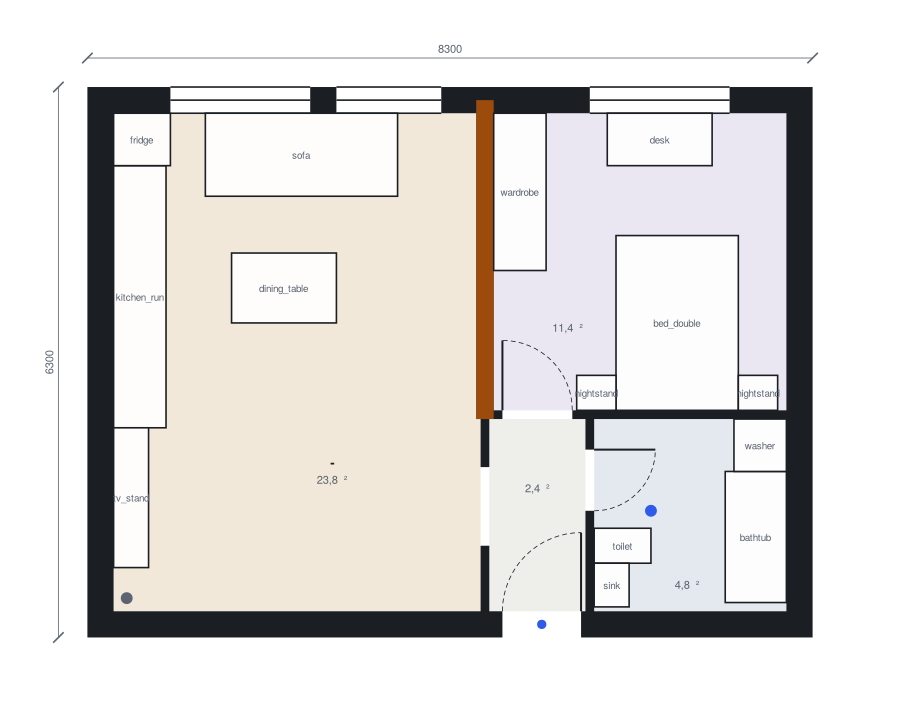
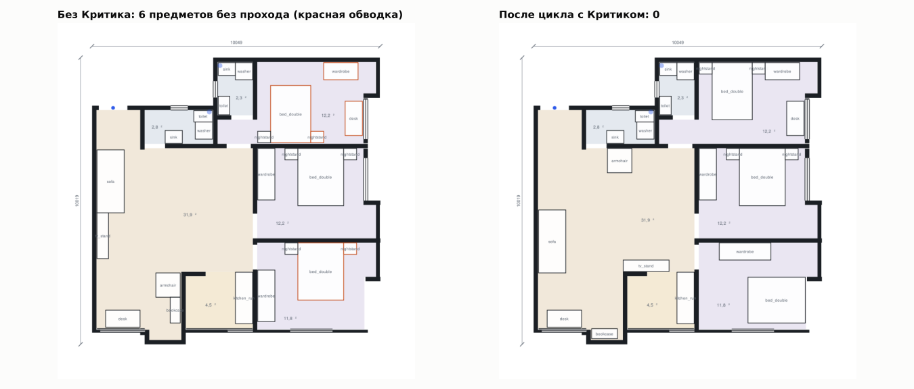
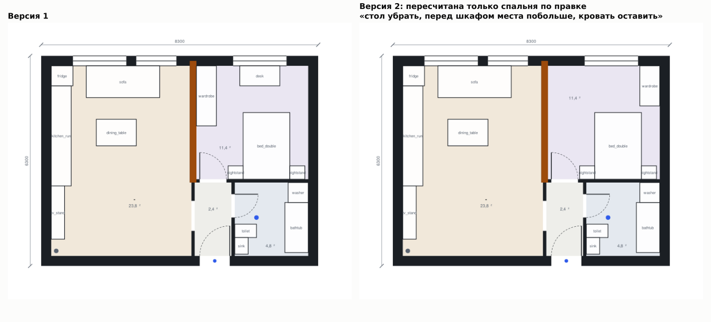
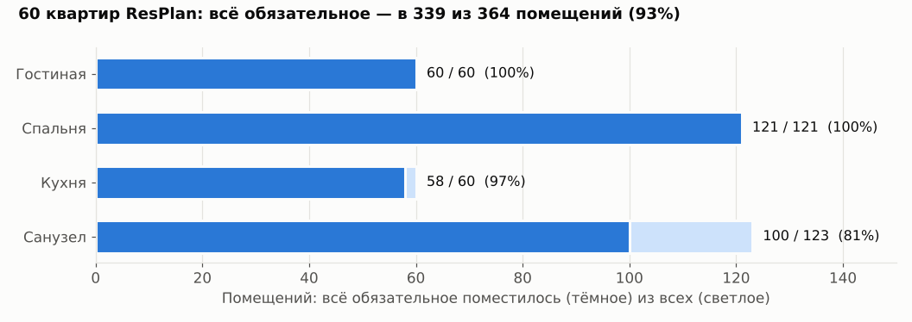
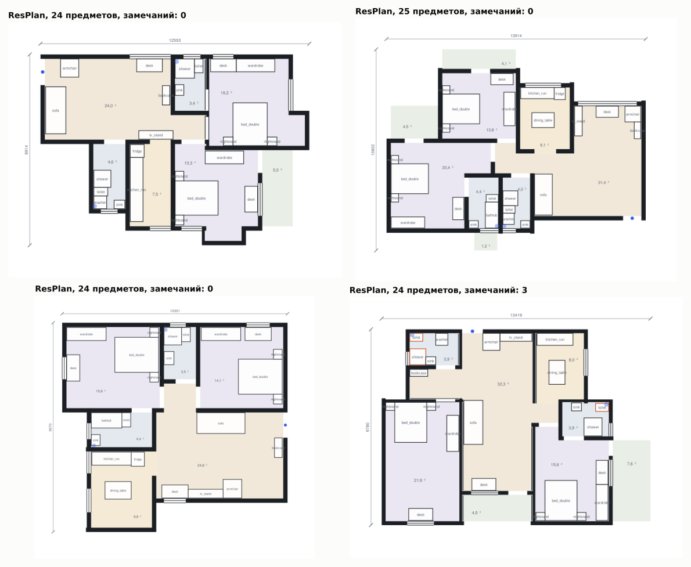
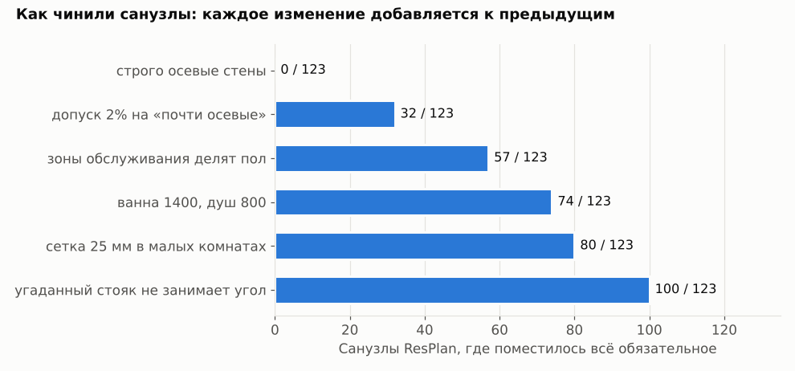

# Расстановка v0 (шаг 3)

Мебель и сантехника расставляются без LLM: агенты будут только переводить пожелания
и правки в ограничения (`Constraint`), а координаты считает солвер.



```
Plan + Brief + Constraints
  → catalog.program_for(тип, площадь)     что поставить в комнату
  → solver.solve_room (CP-SAT)            куда поставить, отдельно для каждой комнаты
  → geometry.check_layout (Критик)         пересечения, двери, проходы
  → комнаты с замечаниями пересчитываются  (до 2 раундов, вариант берём, если не хуже)
  → Layout
```

## Каталог (`catalog.py`)

У каждого предмета: размеры (от предпочтительного к компактному), зона обслуживания перед
лицевой стороной (`clear_front`) или со всех сторон (`clear_around`, обеденный стол),
нужна ли стена за спиной, нужна ли вода (`plumbing`), тянется ли к окну.
Пристройки (`attach`): тумбочки у кровати и холодильник у кухонного гарнитура ставятся
одним комплектом, а потом раскладываются на отдельные предметы с id вида `r2_bed_nightstand_l0`.

Набор для комнаты зависит от типа и площади: в спальне — кровать, шкаф и стол (вес стола выше,
если в брифе указана удалённая работа), в санузле — ванна или душ, унитаз, раковина и
по возможности стиральная машина. «Санузел» меньше 2,2 м² считается туалетом.

## Солвер одной комнаты (`solver/room.py`)

- Сетка 50 мм, в комнатах меньше 8 м² — 25 мм (в санузле шаг 50 мм съедал до 10 см ширины,
  и ванна 1400 переставала помещаться в нишу 1460).
- Каждый вариант «предмет × размер × комплект или без пристроек × поворот» —
  опциональный прямоугольник в `NoOverlap2D`. Из вариантов одного запроса выбирается не больше одного.
- **Зоны обслуживания делят общий пол.** В общем `NoOverlap2D` предмет участвует вместе
  с половиной своей зоны. Поэтому между двумя предметами лицом друг к другу остаётся сумма половин,
  а зоны унитаза и раковины могут перекрываться. Отдельно проверяется, что полная зона
  каждого предмета лежит в комнате и не попадает на створку двери.
- Створки дверей заняты всегда. Подходы к проёмам (750 мм внутрь комнаты) нельзя занимать
  предметами, но зоны обслуживания на них заходить могут.
- «У стены» — дизъюнкция по почти осевым отрезкам контура длиной от 300 мм
  (допуск 2%, срезанные углы ResPlan не мешают).
- Сантехника — не дальше 1500 мм (по L∞) от стояка комнаты. Угаданный стояк (`inferred`)
  задаёт только радиус и места не занимает.
- Цель: сначала все обязательные предметы (вес 10 000), потом необязательные по весу,
  потом предпочтения: первая альтернатива (ванна лучше душа), комплект с пристройками,
  крупный размер; штраф за расстояние до окна или до цели правила `near`.

Ограничения, которые солвер уже понимает: `exclude`, `keep` (вместе с пристройками),
`min_clearance`, `against_wall` (hard), `near` (окно или объект плана), `within_riser_radius`.
`facing` и `in_room` пока игнорируются, и солвер пишет об этом в заметках к комнате.

## Критик (`geometry/clearance.py`)

Ошибки: предмет выходит за комнату, предметы пересекаются, предмет мешает открыть дверь.
Предупреждение `no_passage`: от двери к предмету нет прохода шириной 700 мм
(в санузле — 600 мм). Проход проверяется морфологически: свободный пол сжимается
на половину ширины прохода. Пристройку достаточно достать через её основной предмет.

На `no_passage` реагирует цикл в `solver/layout.py`. Комната пересчитывается: зона обслуживания
предметов с замечанием увеличивается на ширину прохода. Это первый настоящий цикл
«Критик → Планировщик»: замечание превращается в ограничение с `source=system`.



*Слева — первый проход солвера. У кроватей, шкафа и стола в двух спальнях нет прохода от двери
шириной 700 мм. Справа — после пересчёта этих комнат: кровати развёрнуты, проходы есть.*

## Частичная перегенерация

`generate_layout(..., previous=layout, rooms=["r2"])` пересчитывает только перечисленные
комнаты, остальные предметы переносятся без изменений. Ограничение `keep` фиксирует предмет.
В CLI:

```bash
uv run aidesign layout data/demo/demo_48.json -o out/demo_layout.json
uv run aidesign layout out/demo_layout.json --rooms r2 --keep r2_bed --seed 1
```

Вторая команда сохраняет новую версию состояния (`version` + 1, `parent_version`).



*Правка пользователя превращается в три ограничения: `keep r2_bed`, `exclude desk`,
`min_clearance wardrobe 900`. Пересчитывается только спальня; кухня-гостиная и санузел
остаются прежними предмет в предмет.*

## Метрики

Метрика без разметки — доля помещений, куда поместилось всё обязательное, и число
замечаний Критика. Сделано на 60 случайных квартирах ResPlan (seed 7), прошедших валидатор,
лимит 5 с на комнату:



| Тип | Всё обязательное поместилось |
|---|---|
| гостиная | 60 / 60 |
| спальня | 121 / 121 |
| кухня | 58 / 60 |
| санузел | 100 / 123 |
| **всего** | **339 / 364 (93%)** |



- Время: медиана 0,9 с на квартиру, максимум 1,9 с (на 8 потоках).
- Ошибок Критика (пересечения, выход за комнату, блокировка двери): 0.
- Предупреждений `no_passage`: 42 на 60 квартир (до цикла с Критиком было 105).
- Демо-квартира: всё поставлено, замечаний нет.



## Известные ограничения

- Солвер работает в 8 потоков, поэтому при одном и том же `seed` расстановка может немного
  отличаться от запуска к запуску. Для воспроизводимых картинок нужен один поток.

- Не поставились: в основном ванна или душ в узких санузлах ResPlan (17) и унитаз (6).
  Часть из них — совмещённые санузлы шириной ~1,2 м, куда поместится только душ 700 мм.
  Таких размеров в каталоге пока нет.
- Нет связи «диван напротив ТВ» (`facing`) и зонирования кухни-гостиной: в открытой планировке
  предметы расставляются по одной комнате без учёта сценариев.
- Стены — только почти осевые. Скошенные стены не используются как опора.
- Стояк один на комнату (берётся первый). Для кухни без стояка радиус не проверяется.
- На распознанных планах качество расстановки ограничено распознаванием: лишняя «дверь» с
  огромной створкой или неверный тип комнаты (`infer_room_types`, уверенность 0,4) ломают
  программу комнаты. Например, на `tg_3510` санузел остался пустым.
